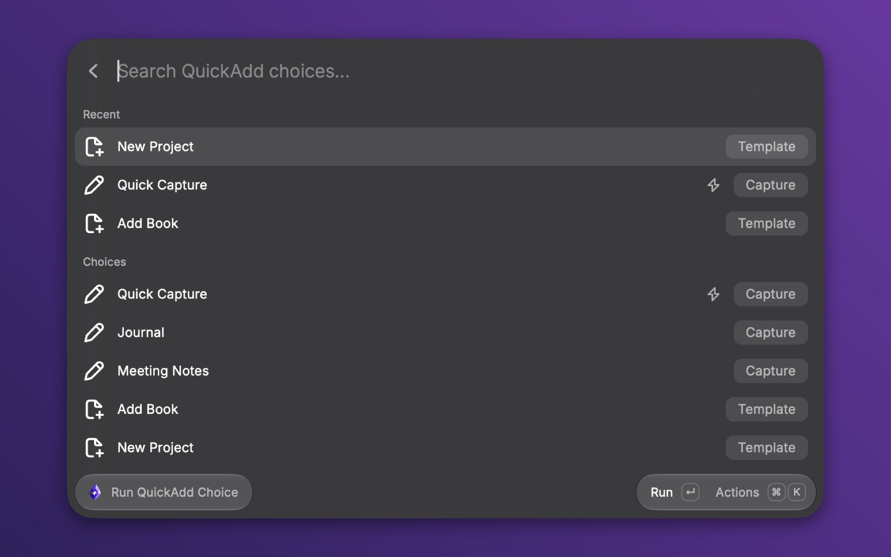

# QuickAdd for Raycast

Run your [QuickAdd](https://github.com/chhoumann/quickadd) choices from Raycast. The forms, the pickers, and the finish message are Raycast's. The work is QuickAdd's, running inside Obsidian through Obsidian's command-line interface. I write QuickAdd, and this is its official Raycast extension.



Install it from the [Raycast Store](https://www.raycast.com/christian_bager_bach_houmann/quickadd). The [extension's README](extension/README.md) shows what it can do and what it needs.

## Layout

- `extension/` is the extension, and the only folder that ships to the store.
- `demo-vault/` is the vault in the pictures. `scripts/setup-demo-vault.sh` downloads the QuickAdd release it expects.
- `e2e-vault/` has one QuickAdd choice per field kind and a macro script that raises every script prompt. `scripts/e2e-protocol.mts` drives them all through the real plugin.
- [ARCHITECTURE.md](ARCHITECTURE.md) has the protocol, the vault lookup, and the reasons behind each choice.

## Development

```bash
cd extension
npm install
npm run dev     # ray develop: installs into Raycast in watch mode
npm run lint    # ray lint: manifest, code, and store screenshots
npm test        # unit tests for field parsing, completion, and the run state machine
npm run build
```

For the end-to-end run, build QuickAdd in `~/Developer/quickadd` (or set `QUICKADD_DIR`), run `scripts/setup-e2e-vault.sh` to copy the plugin in, and open `e2e-vault/` in Obsidian once with **Open folder as vault**. Then, from the repo root:

```bash
node --disable-warning=MODULE_TYPELESS_PACKAGE_JSON scripts/e2e-protocol.mts
```

It runs every choice through `quickadd:interactive`, answers each prompt the way the extension would, and checks the notes QuickAdd writes to `e2e-vault/Output/`. QuickAdd keeps a finished run for a minute and allows 32 at once, so wait a minute before running it again.

To open a choice against either vault from a deeplink, URL-encode `{"vaultPath":"<repo>/demo-vault","choiceId":"quick-capture"}` and append it as `?context=` to `raycast://extensions/christian_bager_bach_houmann/quickadd/run-choice`.

`npm run publish` in `extension/` updates the store submission.

## License

[MIT](LICENSE)
